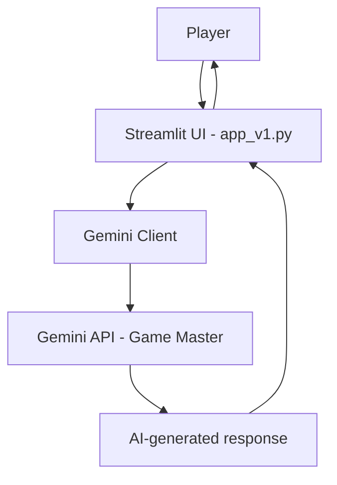
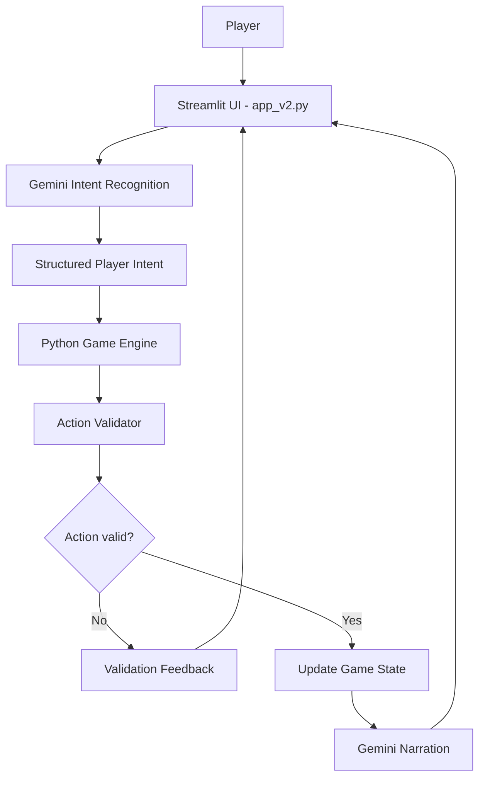

# AI-Powered Escape Room - The Forgotten Library

An interactive AI-powered escape room built with Python, Streamlit, and Google Gemini. This project explores two approaches to AI-driven gameplay: a conversational Version 1 and a structured, rule-validated Version 2.

## Project Overview

The player is trapped inside a mysterious forgotten library and must investigate objects, solve puzzles, collect items, and unlock the exit.

### Game Objectives
- Examine objects and discover clues.
- Solve three puzzles.
- Unlock the drawer and collect the brass key.
- Investigate the painting.
- Discover the final exit code and escape.

## Version 1  Conversational AI

Version 1 uses Gemini as the Game Master. The player interacts through a Streamlit chat interface, and Gemini responds to player actions.

**Limitation:** Game rules are primarily handled through AI-generated conversation, making progression and puzzle validation less deterministic.

## Version 2  Structured Game Engine

Version 2 introduces a modular Python game engine.

- Gemini interprets natural-language player intentions.
- Python validates actions against game rules.
- Game state tracks inventory, solved puzzles, and progress.
- Gemini narrates outcomes after the game engine validates them.

This separates language understanding from game-rule enforcement.

## Technology Stack
- Python
- Streamlit
- Google Gemini API
- google-genai
- python-dotenv
- pytest

## Project Structure

```text
AI-Escape-Room/
 ai/
 assets/
 game/
 tests/
 .env.example
 .gitignore
 app.py
 app_v1.py
 app_v2.py
 requirements.txt
 README.md
```

## Installation

### 1. Clone the repository

```bash
git clone https://github.com/PRAJWAL2866/AI-Escape-Room.git
cd AI-Escape-Room
```

### 2. Create a virtual environment

```powershell
python -m venv .venv
.venv\Scripts\Activate.ps1
```

### 3. Install dependencies

```bash
pip install -r requirements.txt
```

### 4. Configure Gemini API

Create a local `.env` file using `.env.example` as a template.

```dotenv
GEMINI_API_KEY=your_gemini_api_key_here
GEMINI_MODEL=gemini-3.8-flash
```

Replace the placeholder with your own Gemini API key. Use a model supported by your Gemini API account.

**Important:** Never upload your `.env` file.

## Run the Application

### Version 1

```bash
streamlit run app_v1.py --server.port 8501
```

Open http://localhost:8501.

### Version 2

```bash
streamlit run app_v2.py --server.port 8502
```

Open http://localhost:8502.

## Architecture

### Version 1  AI-driven conversation



### Version 2  Validated game engine



## Testing

Run the automated tests:

```bash
pytest -v
```

Important scenarios to verify:

1. Attempting to escape without solving the puzzles.
2. Entering an incorrect drawer code.
3. Attempting to collect the key before unlocking the drawer.
4. Investigating the painting without the required key.
5. Attempting to unlock the exit before completing the required steps.

Record the actual test results before submission.

## Version 1 vs Version 2

| Area | Version 1 | Version 2 |
|---|---|---|
| Interaction | Conversational AI | Structured intent and game actions |
| Game rules | Primarily AI-driven | Python-controlled |
| Validation | Less deterministic | Explicit action validation |
| State management | Conversation-focused | Dedicated game state |
| Architecture | Simpler | Modular |
| AI role | Game Master | Intent recognition and narration |

## Security
- API credentials are stored in a local `.env` file.
- `.env` is excluded through `.gitignore`.
- `.env.example` provides a safe configuration template.
- Never publish API keys or private credentials.

## Future Improvements
- Add more rooms and puzzle variations.
- Introduce difficulty levels.
- Add persistent player progress.
- Improve natural-language intent recognition.
- Expand automated test coverage.

## Author

**Prajwal Dattatray Phalke**  
MSc Data Science  
University of Europe for Applied Sciences

